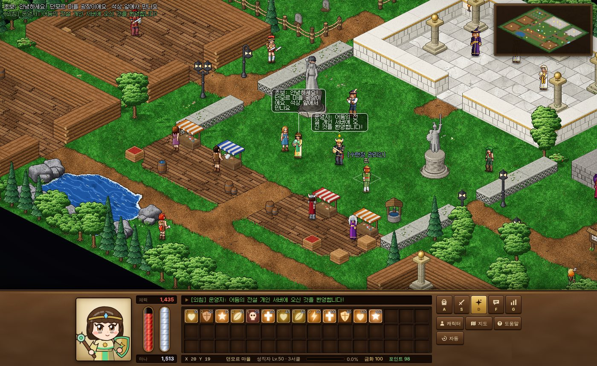
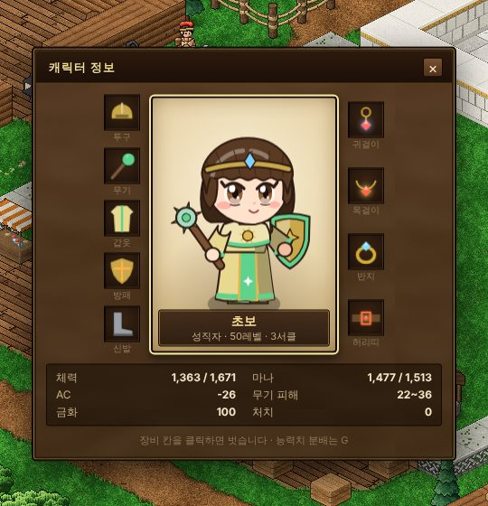
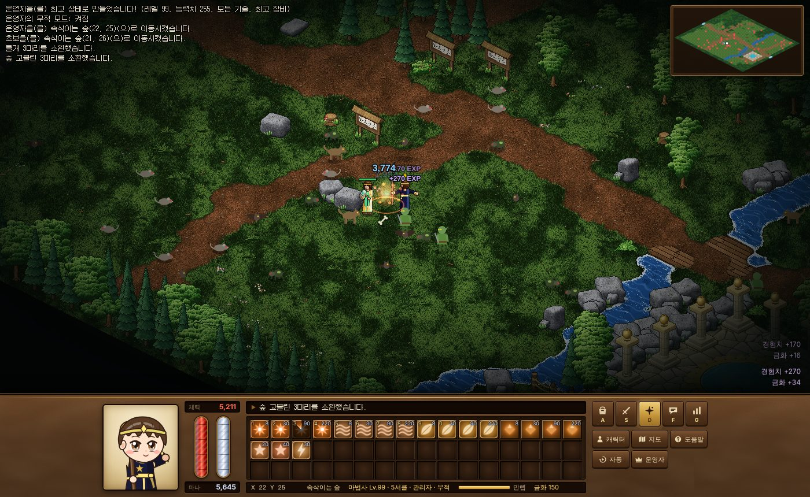
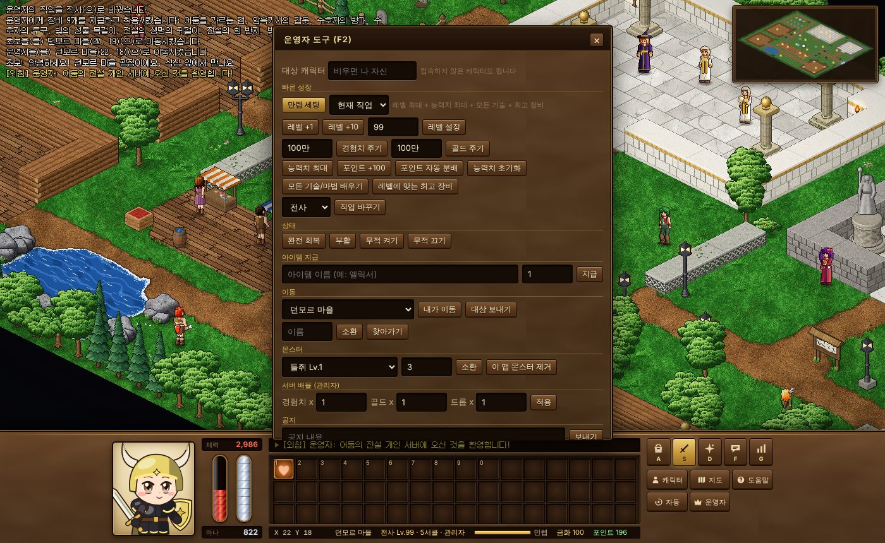
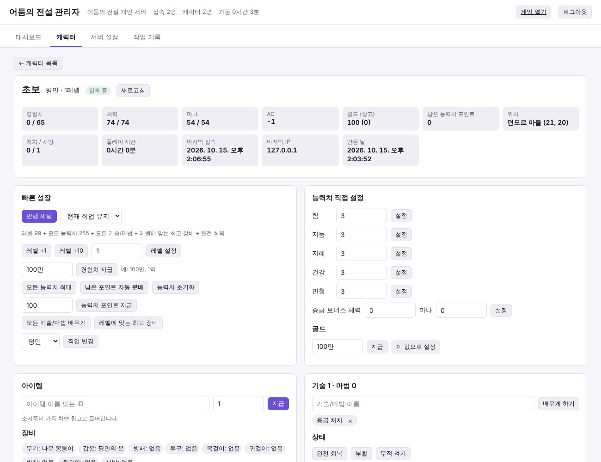

# 어둠의 전설 — 개인 서버

내 서버에서만 돌아가는 **어둠의 전설 스타일 2D MMORPG**입니다. 게임 서버, 웹 브라우저 클라이언트, 관리자 도구가 한 프로그램에 들어 있습니다.
서버를 켜면 같은 주소에서 바로 게임을 할 수 있고, 관리자는 **버튼 한 번**으로 캐릭터를 만렙·최고 장비·모든 기술 상태로 만들 수 있습니다.



> **알려 드립니다.** 이 프로젝트는 넥슨의 「어둠의 전설」에서 영감을 받아 **처음부터 새로 만든 팬 프로젝트**입니다.
> 넥슨의 클라이언트·그래픽·데이터·서버 코드는 전혀 쓰지 않았고(모든 그림은 코드로 직접 그립니다), 공식 클라이언트와 연결되지도 않습니다.
> 공식 게임의 사설 서버(공식 클라이언트 접속용)는 저작권과 「게임산업진흥에 관한 법률」 문제가 있어 만들지 않았습니다.

---

## 목차

1. [주요 기능](#주요-기능)
2. [빠른 시작](#빠른-시작)
3. [관리자: 캐릭터를 빠르게 키우는 방법](#관리자-캐릭터를-빠르게-키우는-방법)
4. [게임 방법](#게임-방법)
5. [서버 설정 (.env)](#서버-설정-env)
6. [내 서버에서만 운영하기](#내-서버에서만-운영하기)
7. [게임 데이터 고치기](#게임-데이터-고치기)
8. [개발](#개발)

---

## 주요 기능

**게임**
- 아이소메트릭(쿼터뷰) 2D 화면, 타일 단위 이동, 실시간 전투
- 클래식 어둠의 전설 배치의 화면: 아래 가죽 패널에 체력/마나 관, 메시지 줄, 소지품·기술·마법·대화·능력치 칸(A/S/D/F/G), 좌표·지역 줄
- 큰 머리·큰 눈의 SD(치비) 캐릭터: 직업마다 다른 의상(전사 뿔 투구·갑옷·망토, 도적 두건·목도리, 마법사 고깔 두건·로브, 성직자 베일·사제복, 무도가 머리띠·도복), 남녀·머리 모양 6종·머리색 12종
- 캐릭터·NPC 일러스트: 접속 화면 직업 일러스트, 캐릭터 창(C)의 내 캐릭터 일러스트와 장비, NPC 대화창 초상
- 직업 5종 + 평민: 전사 · 도적 · 마법사 · 성직자 · 무도가 (5레벨에 길드에서 전직)
- 서클(1~5서클), 능력치 5종(힘·지능·지혜·건강·민첩), AC, 불·물·바람·땅·빛·어둠 속성 상성
- 기술/마법 60여 종 (4원소 마법, 치유·부활·저주·마비, 은신·암살, 기공 등), 버프/디버프
- 아이템 176종 (직업별 무기·갑옷 8단계, 투구·방패·신발, 속성 목걸이/허리띠, 반지, 귀걸이, 물약, 주문서)
- 맵 9곳: 마을, 숲, 지하묘지 1·2층, 잿빛 평원, 수정 동굴, 망자의 탑, 어둠의 심연, 수련장 — 1~99레벨 사냥터와 보스 6종
- 몬스터 AI(배회·선공·추격·마법), 전리품, 사망 시 유령 → 신전 부활, 만렙 이후 승급(경험치 → 최대 체력/마나)
- NPC 상점·전직·기술 배우기·창고·순간이동·능력치 초기화, 그룹(파티) 경험치 분배, 채팅(말하기·외치기·귓속말·그룹)
- 클릭 이동(길찾기), 인접한 적 자동 조준 공격, 어두운 던전의 횃불·용암·수정 조명, 미니맵

**관리자 (빠르고 자유로운 성장)**
- 게임 안 **F2 운영자 도구**: 만렙 세팅, 레벨·경험치·능력치·포인트·기술·장비·골드·아이템 지급, 직업 변경, 무적, 이동, 몬스터 소환, 배율, 공지
- **채팅 명령어** 40여 개 (`/만렙 전사`, `/레벨 99`, `/경험치 100만`, `/아이템 엘릭서 10` …)
- **웹 관리자 페이지** `/admin`: 접속하지 않은 캐릭터까지 검색·편집, 서버 배율/가입 설정, 작업 기록

**내 서버 전용**
- 외부 서비스 없이 혼자 동작 (저장은 `data/` 폴더의 JSON 파일)
- 가입 제한(누구나 / 초대 코드 / 막기), 비밀번호 해시 저장, 로그인·메시지 속도 제한, 서버가 모든 판정을 하는 구조

| 접속 화면 (직업 일러스트) | 캐릭터 창 (C) |
| --- | --- |
|  |  |
| 전투 (수정 동굴) | 운영자 도구 (F2) |
|  |  |

> 모든 그림(캐릭터, 일러스트, 타일, 아이콘, 화면 장식)은 코드로 직접 그린 것이며, 공식 게임의 그림 파일은 쓰지 않았습니다.

---

## 빠른 시작

### 방법 1. Node.js 로 실행

[Node.js](https://nodejs.org) 20.10 이상(22 권장)이 필요합니다.

```bash
git clone https://github.com/squirrel337/Legend_Of_Darkness.git
cd Legend_Of_Darkness
npm ci
npm run build
cp .env.example .env      # 선택: 관리자 비밀번호, 배율 등을 정할 수 있습니다
npm start
```

콘솔에 다음과 같이 나오면 성공입니다.

```
어둠의 전설 개인 서버 시작!
  게임:        http://localhost:7777/
  관리자 페이지: http://localhost:7777/admin
  관리자 비밀번호(자동 생성): ••••••••
```

1. 브라우저에서 `http://서버주소:7777` 에 접속합니다.
2. **새 캐릭터**를 만듭니다. **서버의 첫 번째 캐릭터는 자동으로 관리자가 됩니다.** (캐릭터가 하나도 없는 상태로 서버를 켰을 때 처음 만든 한 명만)
3. 게임 안에서 **F2** 를 누르면 운영자 도구가 열립니다.


### 방법 2. Docker 로 실행

```bash
cp .env.example .env            # 선택
docker compose up -d --build
docker compose logs -f lod      # 자동 생성된 관리자 비밀번호 확인
```

캐릭터 데이터는 `lod-data` 볼륨에 저장되므로 컨테이너를 지우고 다시 만들어도 남습니다.
포트를 바꾸려면 `.env` 의 `PORT` 값을 바꾸세요(호스트 쪽 포트가 바뀝니다).

---

## 관리자: 캐릭터를 빠르게 키우는 방법

### A. 게임 안 운영자 도구 (F2)

운영자(GM)·관리자 권한이 있는 캐릭터로 접속해서 **F2** 를 누르세요.

- **만렙 세팅**: 레벨 99 + 모든 능력치 최대 + 직업의 모든 기술/마법 + 레벨에 맞는 최고 장비 + 완전 회복을 한 번에
- 레벨 +1 / +10 / 직접 설정, 경험치·골드 지급(`100만`, `1억` 같은 입력 가능)
- 능력치 최대 / 포인트 지급 / 자동 분배 / 초기화, 모든 기술 배우기, 최고 장비, 직업 변경
- 완전 회복, 부활, 무적 켜기/끄기, 아이템 지급(이름 검색), 맵 이동, 사람 소환/찾아가기, 몬스터 소환/제거
- 서버 배율(관리자만), 전체 공지
- 위쪽 **대상 캐릭터** 칸에 이름을 넣으면 다른 사람(접속하지 않은 캐릭터 포함)에게 적용됩니다.

### B. 채팅 명령어

`Enter` 를 눌러 채팅창에 입력합니다. `[이름]` 을 생략하면 자기 자신에게 적용됩니다.
`[이름]` 자리에 `@이름` 을 쓰면 그런 캐릭터가 없을 때 오류를 내고 멈춥니다(이름을 잘못 써서 내 캐릭터가 바뀌는 일을 막음, F2 도구는 항상 이 방식). 예) `/레벨업 @철수 10`
숫자는 `100만`, `1억`, `10k`, `1m` 처럼 쓸 수 있습니다.

| 명령어 | 설명 |
| --- | --- |
| `/만렙 [이름] [직업]` | 만렙 + 능력치 최대 + 모든 기술 + 최고 장비. 예) `/만렙 전사`, `/만렙 철수 마법사` |
| `/레벨 [이름] 레벨` | 레벨 설정 (오른 만큼 능력치 포인트 지급) |
| `/레벨업 [이름] [수]` | 레벨 올리기 (기본 1) |
| `/경험치 [이름] 양` | 경험치 지급 (레벨업 처리 포함) |
| `/스탯 [이름] 힘\|지능\|지혜\|건강\|민첩\|전체 값` | 능력치 설정 |
| `/스탯최대 [이름]` · `/포인트 [이름] 수` · `/자동분배 [이름]` · `/스탯초기화 [이름]` | 능력치 관리 |
| `/직업 [이름] 전사\|도적\|마법사\|성직자\|무도가\|평민` | 직업 변경 |
| `/배우기 [이름] 전부\|기술이름` | 기술/마법 배우기 |
| `/장비 [이름]` | 레벨·직업에 맞는 최고 장비 착용 |
| `/아이템 [이름] 아이템 [개수]` | 아이템 지급. 예) `/아이템 엘릭서 10`, `/아이템 현자의 서 5` |
| `/골드 [이름] 양` | 골드 지급 (음수면 차감) |
| `/보너스 [이름] 체력 마나` | 승급 보너스(추가 최대 체력/마나) 설정 |
| `/회복 [이름]` · `/부활 [이름]` · `/무적 [이름] [켜기\|끄기]` | 상태 |
| `/이동 맵 [x y]` · `/보내기 이름 맵 [x y]` · `/소환 이름` · `/찾아가기 이름` | 이동 |
| `/몬스터 이름 [수]` · `/몬스터제거` | 몬스터 소환 / 현재 맵 정리 |
| `/공지 내용` · `/정보 이름` · `/저장` · `/추방 이름 [사유]` | 운영 |
| `/배율 경험치\|골드\|드롭 값` | 서버 배율 (관리자) |
| `/권한 이름 일반\|운영자\|관리자` · `/금지 이름 [사유]` · `/금지해제 이름` | 계정 (관리자) |

맵 이름: `town`(던모르 마을) `forest`(속삭이는 숲) `crypt1`·`crypt2`(지하묘지) `plains`(잿빛 평원) `cave`(수정 동굴) `tower`(망자의 탑) `abyss`(어둠의 심연) `training`(수련장)

경험치 책 아이템(`경험의 서` 1만 · `지식의 서` 10만 · `현자의 서` 100만 · `전설의 서` 1000만)은 상점에서 팔지 않는 관리자 지급용입니다.

### C. 웹 관리자 페이지 (`/admin`)

`http://서버주소:7777/admin` 에서 관리자 비밀번호로 로그인합니다.



- **대시보드**: 접속자 수, 지역별 플레이어/몬스터 수, 배율 변경, 공지, 즉시 저장
- **캐릭터**: 검색 → 상세 화면에서 만렙 세팅, 레벨·경험치·능력치·승급 보너스·골드·아이템·기술·직업·위치 변경, 장비/소지품 정리, 권한·비밀번호·접속 금지·강제 종료·삭제
- **서버 설정**: 서버 이름, 인사말, 배율, 가입 방식, 초대 코드, 사망 경험치 손실, 시작 레벨, 전직 레벨 (실행 중 바로 적용)
- **작업 기록**: 누가 언제 무엇을 바꿨는지 (`data/admin-audit.log`)

접속 중인 캐릭터는 바꾸는 즉시 게임 화면에 반영되고, 접속하지 않은 캐릭터는 저장 파일이 바로 수정됩니다.

### 관리자 권한 주기

- **첫 캐릭터**: 캐릭터 파일이 하나도 없는 상태로 서버를 켰을 때, 처음 만든 캐릭터 **한 명만** 관리자가 됩니다.
  그 캐릭터를 지워도 다음에 만든 사람이 관리자가 되지는 않습니다. (`FIRST_CHARACTER_ADMIN=false` 로 끌 수 있음)
  인터넷에 공개할 서버라면 다른 사람에게 주소를 알려 주기 전에 내 캐릭터부터 만드세요.
- `.env` 의 `ADMIN_CHARACTERS=이름1,이름2`: **서버를 켜기 전에 이미 있던** 캐릭터가 접속하면 관리자가 됩니다.
  적어 둔 이름은 예약되어 새로 만들 수 없습니다 (남이 먼저 그 이름으로 캐릭터를 만들어 관리자 권한을 가로채지 못하게).
  순서: 캐릭터를 만든다 → `.env` 에 이름을 적는다 → 서버를 다시 켠다.
- 웹 관리자 페이지의 캐릭터 상세 → **권한 변경** (일반 / 운영자(GM) / 관리자).
- 서버를 끈 상태에서 명령줄로: `node dist/server.js --set-role 이름 admin`

운영자(GM)는 성장·이동·소환·공지 명령을, 관리자는 여기에 더해 배율·권한·접속 금지를 쓸 수 있습니다.
운영자(GM)의 명령은 자기 자신과 일반 플레이어에게만 쓸 수 있고, 다른 운영자나 관리자는 대상으로 삼을 수 없습니다.

---

## 게임 방법

### 조작

| 키 | 동작 |
| --- | --- |
| 방향키 / 땅 클릭 | 이동 (클릭하면 길을 찾아 이동) |
| 스페이스 | 앞의 적 공격 (누르고 있으면 계속, 붙어 있는 적 쪽으로 자동으로 돌아섬) |
| 1 ~ 0 | 아래 칸(소지품/기술/마법)의 1~10번째 칸 사용 · NPC 대화창에서는 선택지 |
| A / S / D / F / G | 아래 칸 바꾸기: 소지품 / 기술 / 마법 / 대화 기록 / 능력치 |
| C | 캐릭터 창 (일러스트와 장비, 장비 칸 클릭으로 벗기) |
| M | 지도 켜기/끄기 |
| Q / W | 체력 물약 / 마나 물약 |
| Tab / 몬스터 클릭 | 대상 지정 (마법은 지정한 대상에게 날아감) · 같은 몬스터를 다시 클릭하면 다가감 |
| NPC 클릭 | 대화 (멀면 걸어가서 말을 걺) |
| E / 아이템 클릭 | 줍기 |
| R | 유령일 때 마을로 돌아가기 |
| Enter / 메시지 줄 클릭 | 대화 입력 (`!외치기`, `@이름 귓속말`, `#그룹 대화`, `/명령어`) |
| H | 도움말 · F2: 운영자 도구 · Esc: 창 닫기 |

### 직업 (5레벨부터 마을 길드에서 전직)

| 직업 | 특징 | 길드 위치 |
| --- | --- | --- |
| 전사 | 높은 체력, 강타·회오리 베기·돌진·필살(체력을 바쳐 큰 피해) | 서쪽 전사 길드 |
| 도적 | 은신, 급소 찌르기, 독, 비수 던지기, 은신 중 암살 | 남서쪽 도적 길드 |
| 마법사 | 불·물·바람·땅 4원소 × 4단계 마법, 수면, 순간이동 | 북동쪽 마법사 탑 |
| 성직자 | 치유·부활·보호·저주·마비, 빛 속성 공격 | 신전 안 |
| 무도가 | 정권·연환각·장풍(기공), 명상, 금강불괴 | 남동쪽 도장 |

### 사냥터

| 지역 | 권장 레벨 | 가는 길 |
| --- | --- | --- |
| 속삭이는 숲 | 1~12 | 마을 동쪽 문 |
| 던모르 지하묘지 1층 / 2층 | 8~18 / 18~30 | 마을 북서쪽 묘지 |
| 잿빛 평원 | 28~45 | 숲 동쪽 끝 (25레벨 이상) |
| 수정 동굴 | 42~60 | 평원 북쪽 (40레벨 이상) |
| 망자의 탑 | 60~82 | 동굴 깊은 곳 (58레벨 이상) |
| 어둠의 심연 | 80~99 | 탑 꼭대기 (78레벨 이상) |
| 수련장 | — | 수련장 관리인 핀 (때려도 쓰러지지 않는 허수아비) |

여행 안내인 **루**에게 골드를 내면 각 사냥터로 바로 이동할 수 있습니다.

### 알아 두면 좋은 것

- **서클**: 1~10레벨 1서클, 11~40 2서클, 41~70 3서클, 71~98 4서클, 99 5서클
- **AC**는 낮을수록(음수일수록) 받는 피해가 줄어듭니다.
- **속성**: 목걸이가 공격 속성, 허리띠가 방어 속성을 정합니다. 불>바람>땅>물>불, 빛↔어둠.
- **사망**하면 유령이 됩니다. 신전 사제 브리드에게 말을 걸거나 성직자의 부활 마법으로 살아납니다.
- **승급**: 만렙 이후에도 경험치가 쌓이고, 승급 장인 오그마에게 50만 경험치당 최대 체력 +100 또는 마나 +50 으로 바꿀 수 있습니다.
- 창고지기 **오언**에게 물건과 골드를 맡길 수 있습니다.

---

## 서버 설정 (.env)

`.env.example` 을 `.env` 로 복사해서 고칩니다. 모든 항목은 생략하면 기본값을 씁니다.

| 항목 | 기본값 | 설명 |
| --- | --- | --- |
| `PORT` / `HOST` | `7777` / `0.0.0.0` | 접속 포트와 주소. 이 컴퓨터에서만 쓰려면 `HOST=127.0.0.1` |
| `SERVER_NAME` / `MOTD` | | 서버 이름 / 접속 인사말 |
| `ADMIN_PASSWORD` | 자동 생성 | 웹 관리자 비밀번호. 비우면 `data/admin-password.txt` 에 만들어 둠 |
| `ADMIN_CHARACTERS` | | 관리자로 만들 **기존** 캐릭터 이름 (쉼표 구분). 이 이름으로는 새 캐릭터를 만들 수 없음 |
| `FIRST_CHARACTER_ADMIN` | `true` | 캐릭터가 하나도 없을 때 처음 만든 캐릭터에게 관리자 권한 |
| `REGISTRATION` | `open` | `open`(누구나) / `invite`(초대 코드) / `closed`(생성 불가) |
| `INVITE_CODE` | | `REGISTRATION=invite` 일 때 필요한 코드 |
| `EXP_RATE` / `GOLD_RATE` / `DROP_RATE` | `1` | 배율 |
| `MAX_LEVEL` / `STAT_CAP` | `99` / `255` | 최대 레벨 / 능력치 분배 상한 |
| `STAT_POINTS_PER_LEVEL` | `2` | 레벨당 능력치 포인트 |
| `START_LEVEL` / `CLASS_LEVEL` | `1` / `5` | 새 캐릭터 시작 레벨 / 전직 가능 레벨 |
| `DEATH_EXP_PENALTY` | `0` | 사망 시 현재 레벨 경험치 손실 비율 (0~1) |
| `DATA_DIR` / `AUTOSAVE_SECONDS` | `data` / `30` | 저장 폴더 / 자동 저장 간격 |
| `MAX_PLAYERS` / `MAX_CONNECTIONS_PER_IP` | `200` / `8` | 동시 접속 제한 |
| `TRUST_PROXY` | `false` | 리버스 프록시 뒤라면 `true` (실제 IP 를 `X-Forwarded-For` 의 마지막 값에서 읽음). 프록시 없이 켜면 IP 를 꾸밀 수 있으니 주의 |

배율·가입 방식·인사말 등은 웹 관리자 페이지에서 실행 중에 바꿀 수 있고, 바꾼 값은 `data/settings.json` 에 저장되어 `.env` 보다 우선합니다.

---

## 내 서버에서만 운영하기

- **나 혼자 / 이 컴퓨터에서만**: `HOST=127.0.0.1` 로 두면 다른 컴퓨터에서 접속할 수 없습니다.
- **지인만**: `REGISTRATION=invite` 와 `INVITE_CODE=원하는코드` 를 설정하고 코드를 알려 주세요. 다 만들었으면 `REGISTRATION=closed` 로 막을 수 있습니다.
- **관리자 비밀번호**는 꼭 길고 추측하기 어려운 값으로 바꾸세요. 관리자 로그인은 1분에 10번까지만 시도할 수 있습니다.
- **인터넷에 공개할 때**는 nginx 같은 리버스 프록시로 HTTPS 를 붙이는 것을 권장합니다. WebSocket(`/ws`) 업그레이드를 넘겨 주어야 합니다.

  ```nginx
  server {
      listen 443 ssl;
      server_name game.example.com;
      # ssl_certificate ... ;
      location / {
          proxy_pass http://127.0.0.1:7777;
          proxy_http_version 1.1;
          proxy_set_header Upgrade $http_upgrade;
          proxy_set_header Connection "upgrade";
          proxy_set_header X-Forwarded-For $proxy_add_x_forwarded_for;
          proxy_set_header Host $host;
      }
  }
  ```
  이 경우 `.env` 에 `HOST=127.0.0.1`, `TRUST_PROXY=true` 를 설정하세요.
  서버는 `X-Forwarded-For` 의 **마지막** 값(프록시가 직접 본 IP)을 씁니다. 프록시를 여러 단계 거친다면 마지막 프록시가 실제 IP 를 넘기도록 설정하세요.
- **자동 보호 장치** (따로 설정할 필요 없음)
  - 로그인: IP 당 1분에 10번까지. 한 캐릭터의 비밀번호를 8번 틀리면 그 캐릭터는 10분 동안 로그인할 수 없습니다.
  - 캐릭터 만들기: IP 당 1시간에 10개, 초대 코드는 IP 당 1시간에 10번까지 틀릴 수 있습니다.
  - 로그인하지 않고 3분 넘게 머무는 연결은 끊습니다.
  - 채팅과 명령어: 일반 플레이어는 1초에 1번 (몰아서 5번까지). 운영자·관리자는 제한 없음.
  - 바닥에 버린 물건: 한 사람당 30개, 맵 하나에 400개까지. 맵이 가득 차면 직접 버린 물건부터 치우고, 버리는 사람이 남의 전리품을 밀어내지는 못합니다.
- **백업**: `data/` 폴더(캐릭터 `characters/*.json`, `settings.json`, `admin-audit.log`)를 복사해 두면 됩니다. 캐릭터는 30초마다, 접속 종료 시, 서버 종료(Ctrl+C) 시 저장됩니다.

---

## 게임 데이터 고치기

아이템, 기술, 몬스터, NPC, 맵은 모두 `gamedata/` 폴더의 JSON 파일입니다. 고친 뒤 서버를 다시 켜면 적용됩니다.
서버는 시작할 때 데이터를 검사해서, 없는 아이템을 참조하거나 맵의 워프가 벽 위에 있으면 **어느 파일의 어디가 틀렸는지** 알려 주고 시작하지 않습니다.

| 파일 | 내용 |
| --- | --- |
| `classes.json` | 직업별 체력/마나 성장, 능력치 자동 분배 비율, 전직 시 받는 장비 |
| `items.json` | 아이템 (피해, AC, 추가 능력치, 속성, 가격, 사용 효과, 아이콘 모양/색) |
| `abilities.json` | 기술/마법 (배우는 레벨·가격, 마나, 재사용 대기, 대상 방식, 효과) |
| `monsters.json` | 몬스터 (레벨, 배율, 속성, 선공 여부, 마법, 전리품, 겉모습). 체력·피해·경험치는 레벨로 자동 계산되고 직접 지정할 수도 있음 |
| `npcs.json` | NPC 와 서비스 (상점, 매입, 전직/기술, 부활, 치료, 승급, 이동, 능력치 초기화, 창고, 이야기) |
| `maps/*.json` | 맵 타일(글자 한 개 = 한 칸), 시작 지점, 워프, NPC 위치, 몬스터 생성 |

맵 타일 글자 (`src/shared/tiles.ts`):

| 걸을 수 있음 | | 막힘 | |
| --- | --- | --- | --- |
| `.` 풀밭 `:` 꽃밭 `,` 흙길 `f` 우거진 풀 | `=` 돌바닥 `_` 나무 바닥 `m` 대리석 `g` 판석 광장 `d` 돌 단상 | `#` 돌벽 `W` 나무벽 `H` 신전 벽 `h` 낮은 돌담 | `D` 던전 벽 `K` 동굴 벽 `X` 심연 벽 |
| `-` 던전 바닥 `;` 동굴 바닥 `k` 뼈 무더기 | `s` 모래 `a` 잿빛 땅 `v` 늪 `x` 심연 | `T` `P` `Y` `E` 나무 `R` `r` 바위 `Q` 바위 무더기 `B` 덤불 `F` 울타리 `u` 그루터기 | `~` 물 `L` 용암 `U` 성수 `C` 상자 `O` 통 `A` 제단 `I` 기둥 `G` 묘비 `w` 우물 `t` 탁자 `S` 석상 `c` 수정 `j` 횃불 `l` 가로등 `N` 게시판 `p` 돌 말뚝 `n` 노점 ` `(공백) 빈 곳 |

돌 단상 `d` 는 화면 아래쪽 두 변(x·y 가 커지는 쪽)에 계단이 생기고, 성수 `U` 를 빈칸 없는 정사각형(예: 2x2)으로 두면 둥근 샘으로 그려집니다.

---

## 개발

```bash
npm run dev        # 변경을 감시해서 자동으로 다시 빌드하고 서버를 재시작
npm test           # 테스트 (공식/데이터/캐릭터 로직 + 실제 서버를 띄운 통합 테스트)
npm run typecheck  # 타입 검사
npm run check      # 타입 검사 + 테스트 + 빌드
```

```
src/
  shared/    서버와 클라이언트가 함께 쓰는 상수, 공식, 프로토콜, 타일 정의
  server/    게임 서버 (Node.js + ws)
    world/     맵, 플레이어, 몬스터, NPC, 몬스터 생성기, 틱 루프
    systems/   전투, AI, 이동, 성장, 소지품, NPC 서비스, 채팅, 그룹
    admin/     관리자 기능(AdminService), 채팅 명령어, 관리자 REST API
    net/       WebSocket 세션 (로그인, 메시지 처리)
  client/    브라우저 게임 (캔버스 렌더러 + DOM UI)
  admin/     웹 관리자 페이지
gamedata/    게임 데이터 (JSON)
public/      HTML/CSS, 빌드된 스크립트(public/build)
test/        테스트
```

- 서버가 이동 속도, 사거리, 재사용 대기, 마나, 레벨/직업 조건, NPC 거리 등 **모든 판정**을 합니다. 클라이언트는 화면 표시와 입력만 맡습니다.
- 메시지는 WebSocket(`/ws`) 위의 JSON 이며 형식은 `src/shared/protocol.ts` 에 정의되어 있습니다.
- 런타임 의존성은 `ws` 하나뿐입니다.
